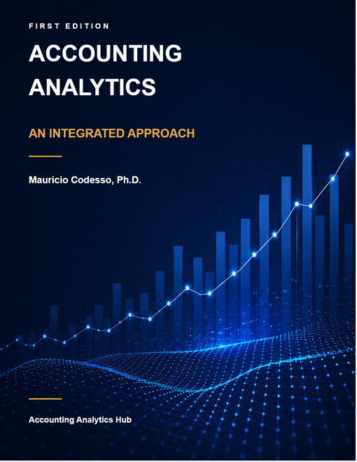

# Accounting Analytics: An Integrated Approach

**Mauricio Codesso**

Welcome to the repository for *Accounting Analytics: An Integrated Approach*, an
open educational resource. The book helps accounting students develop analytical
skills through accounting examples and applications using Excel, SQL, and Power BI.

**[Read the book online](https://aa.accountinganalyticshub.com/)**

The book website is the starting point for reading the chapters and finding
available book downloads and the companion dataset.

<p align="center">
  <a href="https://aa.accountinganalyticshub.com/">
    
  </a>
</p>

## For accounting educators

Designed for undergraduate and graduate accounting courses, the book introduces
analytics through familiar accounting questions. Students need no prior analytics
or programming experience; introductory financial and managerial accounting
knowledge provides the foundation.

The teaching approach combines learning objectives, guided tutorials, and applied
exercises. Examples connect analytical skills to financial accounting, managerial
accounting, and auditing, helping students interpret results from different
professional perspectives.

The shared Charles River Accounting Dataset follows a fictional company and
provides a common setting for learning across Excel, SQL, and Power BI. Instructors
can use the material to support classroom discussion, guided practice, and
independent assignments.

Visit the [Charles River dataset website](https://charlesriver.accountinganalyticshub.com/)
for documentation and additional information. All dataset changes and updates
will be posted there.

**First Edition, Revision 2027.1.** Corrections and improvements are published
as new revisions of the first edition, each with its own release of the PDF,
EPUB, DOCX, slides, and companion files.

## Contributing to the book

Faculty, students, and practitioners are welcome to help improve the book.
Contributions can include:

- Corrections to the text, examples, or exercises.
- Suggestions for clearer explanations or new accounting applications.
- Classroom experiences and ideas for teaching with the material.

**No coding experience is required to share feedback.**
[Report an error or suggest an improvement](https://github.com/mmcodesso/Accounting_Analytics_Book/issues)
through GitHub. You will need a GitHub account. Identify the chapter or section
and describe your suggestion; a proposed correction or example is helpful.

To propose direct edits, see the [contributor guide](CONTRIBUTING.md).

## Building and publishing the book

GitHub Pages serves the website, and GitHub Actions renders it on every push to
`main`: the chapters in HTML and the slides for the browser. Everything readers
download is built on your own computer and published as the files of the book's
current revision, a GitHub release of this repository: the PDF, EPUB, and DOCX,
the PowerPoint decks, and the companion and solution files. **So after every
change to the book, build it locally and publish it.**

Install once:

- [Quarto](https://quarto.org/) 1.10.19, a TeX distribution for the PDF (such as
  MiKTeX), and the [Draw.io desktop app](https://www.drawio.com/) for the figures;
- Python, then `python -m pip install -r scripts/slides/requirements.txt`;
- the [GitHub CLI](https://cli.github.com/), signed in: `winget install --id GitHub.cli`,
  then `gh auth login`.

Then, for every change:

1. Commit your changes on `main`.
2. Run `python scripts/release.py publish`. It builds what is out of date (the
   PDF, EPUB, and DOCX, or only the decks whose sources changed; never the website,
   which GitHub Actions renders), uploads only the files that changed to the
   release of the current revision, and pushes `main`, which deploys the website.
   Add `--dry-run` to see the plan without changing anything.

To preview the website locally as well, run the full build,
`python scripts/build_all.py`; `publish` then reuses its files if nothing changed
since.

The EPUB and the DOCX carry an optimized PNG of each diagram instead of its SVG (whose HTML labels they cannot draw), made automatically from the
Draw.io sources and cached in `outputs/ebook-figures/`. `python -m pip install -r scripts/requirements-ebook.txt`
installs what that needs; `python scripts/build_ebooks.py` builds and checks just those two formats. The
[contributor guide](CONTRIBUTING.md#the-diagrams-in-the-epub-and-the-docx) has the settings and the details.

The release's page lists the book, the dataset, and the slides, companion files, and solutions by chapter, as the
Downloads page does, with a link to this website for the latest version. `publish` writes it each time;
`python scripts/release.py notes` previews it (`--update` puts it on the release without publishing).

`python scripts/release.py status` lists every file: whether it is built, whether
it was built from the current text, and whether the release has the same copy. A
plain `git push` also deploys the website but leaves the downloads as they were;
the workflow's summary then lists the files that are older than the text.

The revision is set in `_variables.yml` (`book.revision`). To start a new one, run
`python scripts/release.py bump <revision>` (for example `2027.2`), update the
revision named near the top of this README, commit, and publish. The new revision gets a tag and release of its own, and earlier revisions
keep theirs. The companion and solution files are built with
`scripts/companion/build.py` and kept, untracked, in `supplementary/` (see
[its README](supplementary/README.md)). The [contributor guide](CONTRIBUTING.md#building-the-book)
has the details.

### The complete build in one command

`python scripts/build_everything.py` runs every step of a build in order and skips each one that is already
current, so after a small change it rebuilds only what the change touches:

1. the fast checks (keys, literals, citation file, deck sources, SQL, quick reference);
2. the book's generated figures and their exports;
3. the companion and solution files: SQL, then Excel (Excel for Microsoft 365 and the environment of
   `scripts/companion/requirements-excel.txt`), then Power BI Desktop, one file at a time;
4. the instructor guides' figures, the guides rendered from their templates and checked, their PDF files, and
   `Instructor-Notes.zip`;
5. the copy of the companion and solution files into `supplementary/`;
6. the book (PDF, EPUB, DOCX, both deck formats, and the website) with `scripts/build_all.py`;
7. the generated notes and the unit tests.

```sh
python scripts/build_everything.py --plan          # what would run, and why; changes nothing
python scripts/build_everything.py                 # build everything that is out of date
python scripts/build_everything.py --only guides   # one stage or unit (--list names them); --skip and --from also work
python scripts/build_everything.py --force all     # run everything again (or --force with a stage or a unit)
python scripts/build_everything.py --no-office     # leave out the Excel and Power BI Desktop builds
python scripts/build_everything.py --print         # also build the print interiors
```

A step is current when nothing it was built from has changed since it ran. A companion file is built from its
Python builder and the modules that builder imports, the chapter text it reads, the dataset, and the files other
steps built for it, so editing the Chapter 7 builder makes only Chapter 7's workbook out of date. The record is
`outputs/build/everything.json`, which is not tracked, so a computer that has built nothing starts with no record
and builds everything once (hours, because of Excel and Power BI Desktop). If its files are already current, run
`python scripts/build_everything.py --adopt` first to record them. `--adopt` refuses a file that is older than one
of its inputs, and says which.

A failed step stops the run and names the log, `outputs/build/everything-last-run.log`. Fix the cause and run the
command again; the steps that finished are skipped.

To build and publish a revision:

```sh
python scripts/build_everything.py                 # build what is out of date
git add -A && git commit                           # commit the text and the files the build changed
python scripts/build_everything.py --publish       # the checks, then release.py publish (--publish-dry-run shows the plan)
```

`--publish` stops while the working tree has uncommitted changes. The second run builds nothing, because the
commit leaves every step current.

### Print editions

The printed book (IngramSpark, US Letter, 8.5 × 11 in) has two interiors, one in
color and one in black and white. They differ from the downloadable PDF:

- no cover (the printer takes the cover as a file of its own);
- print margins;
- black text;
- colors converted to CMYK or gray;
- no links: the chapters have no slide links, and the Downloads page points to the
  website.

Build them with:

```sh
python scripts/print/build.py           # both; --color or --bw for one
python scripts/print/build.py --draft   # while the ISBNs are blank
```

The build needs [Ghostscript](https://ghostscript.com/releases/) (on Windows,
the `gs<version>w64.exe` installer) and PyMuPDF (`python -m pip install pymupdf`).
It writes PDF/X-1a files, checked against IngramSpark's file requirements, to
`outputs/print/`, and they are never part of a release. Before you send them to
the printer:

1. Fill in `isbn.paperback-color` and `isbn.paperback-bw` in `_quarto.yml`.
2. Build without `--draft`.
3. Upload each file and read IngramSpark's error report.
4. Order a printed proof.

The cover is made separately with IngramSpark's cover template, sized from the
final page count.

## Citing the book

If you use this book in your teaching or research, please cite it as:

> Codesso, M. (2027). *Accounting analytics: An integrated approach*. Accounting Analytics Hub. https://aa.accountinganalyticshub.com/

## License and reuse

Unless otherwise noted, this work is licensed under
[Creative Commons Attribution-ShareAlike 4.0 International (CC BY-SA 4.0)](https://creativecommons.org/licenses/by-sa/4.0/).

You may share and adapt the material, including for commercial use. Give
appropriate credit, link to the license, and indicate any changes. Distribute
adaptations under the same license, without adding restrictions that limit the
permissions it provides. See the [repository license](LICENSE) for details.
